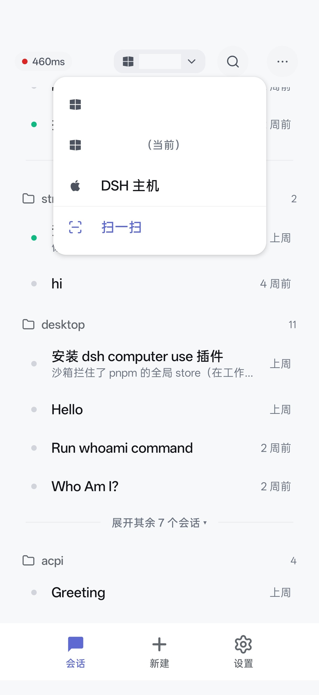
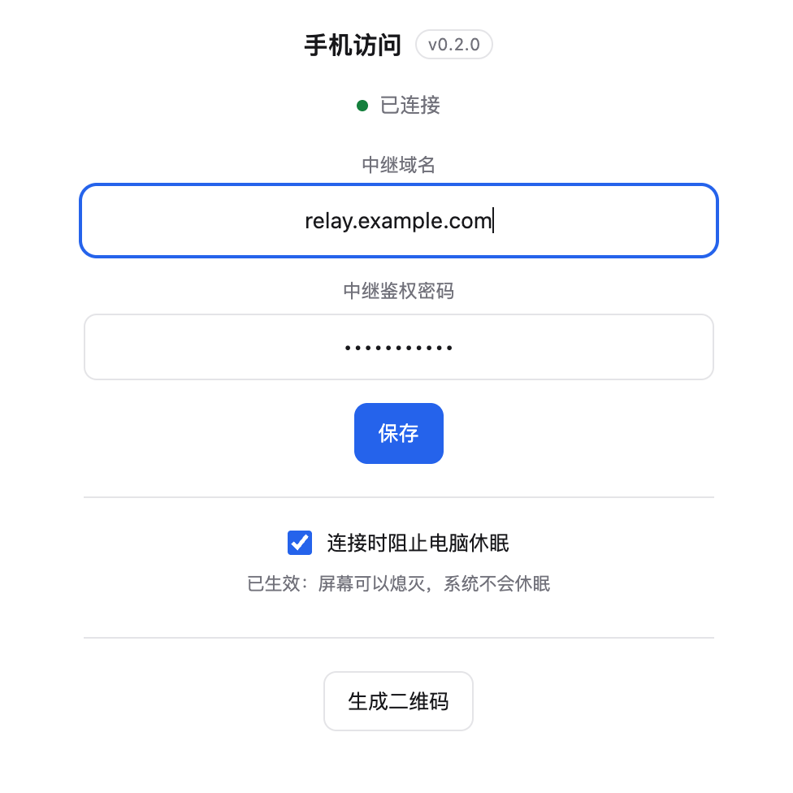

<p align="center">
  
</p>

# dsh-mobile-sh

dsh-mobile-sh 是 [DSH（DeepSeek Harness）](https://github.com/deepseek-ai) 桌面端的**手机遥控器**，同时也是一套可自托管的中继与插件方案；Android 应用显示名为 **BBW**。

电脑上跑 DSH，安装本仓库的主机插件；手机 App 连到自建中继，就能在手机上查看、发送和管理本机 DSH 会话。宿主的 HTTP 接口只监听 `127.0.0.1`，手机永远不直连宿主；插件主动向中继建立加密长隧道，中继只负责鉴权、转发和 14 天会话归档，不保存业务状态。

```
手机 App (Kotlin / Compose)
        │ HTTPS / WSS
        ▼
   中继 relay (Node + SQLite)
        ▲ WSS 长隧道（由插件主动连出）
        │
   DSH 主机插件（跑在 DSH 桌面进程里）
        │ HTTP loopback
        ▼
   DSH 宿主 API (127.0.0.1)
```

## 界面预览

| 手机 App | DSH 插件「手机访问」 |
| --- | --- |
|  |  |

> 截图中的主机名称已脱敏；仓库不保存真实中继地址、口令或密钥。

---

## 仓库结构

| 目录                         | 内容                                                                |
| -------------------------- | ----------------------------------------------------------------- |
| `packages/core/`           | 命名、协议帧、隧道分帧、记录模型、过滤与字节预算                                          |
| `packages/plugin/`         | DSH 主机插件：隧道客户端、SQLite outbox、控制流、插件 UI、热重载                        |
| `packages/relay/`          | 自托管中继：`/native/v2/*`、`/control/*`、`/v2/sync`、SQLite、发布面、Docker 入口 |
| `android/`                 | Kotlin / Compose 手机 App，Room 落盘、Projector 投影、Compose UI           |
| `deploy/`                  | 中继 Dockerfile、compose、nginx 反代示例                                  |
| `scripts/`                 | 构建、发版、命名门禁、本地联调、发布脚本                                              |
| `tests/`                   | TypeScript 测试                                                     |
| `docs/`                    | PRD、部署、插件 UI、坑表                                                   |
| `HANDOFF.md` / `AGENTS.md` | 交接与仓库入口说明                                                         |

---

## 环境要求

| 组件            | 要求                                                               |
| ------------- | ---------------------------------------------------------------- |
| Node.js       | `>= 24.12.0`                                                     |
| JDK / Android | Android 构建需要 JDK 17 与 `ANDROID_HOME`；系统 JDK 26 与 Gradle 8.13 不兼容 |
| Docker        | 中继容器化部署需要 Docker / Docker Compose                                |
| DSH 宿主        | 支持 Node 24 运行插件、Web profile、loopback HTTP 监听                     |

仓库源码不包含任何真实口令、域名、IP 或签名密钥；所有真实地址都通过环境变量或 Gradle 属性注入。

---

## 快速开始

### 0. agent构建

直接把以下prompt发给你的agent, 他会自动进行构建

```bash
查阅并基于@docs/RELAY-DEPLOY.md进行三端构建和部署!
```

### 1. 构建仓库

```bash
export PATH="/path/to/node-24/bin:$PATH"   # 确保 node -v >= 24.12
npm ci
npm run build
npm run check
```

`npm run build` 先生成 `packages/*/dist/` 产物（含 `dist/client.js`）；`npm run check` 再跑类型检查、命名门禁、TypeScript 测试并重新打包。全新 clone 必须先 `npm run build`，否则插件 UI 测试会因读不到 `dist/client.js` 而失败。

Android 单测与 debug 包：

```bash
cd android
export JAVA_HOME=/path/to/jdk-17
export ANDROID_HOME=/path/to/android-sdk
export ANDROID_SDK_ROOT=/path/to/android-sdk
./gradlew :app:testDebugUnitTest :app:assembleDebug
```

> `./gradlew ... | tail` 会吞掉退出码；需要管道时加 `set -o pipefail`。

### 2. 启动中继

只要求一个环境变量 `RELAY_PASSWORD`（至少 12 字符）：

```bash
RELAY_PASSWORD='replace-with-a-long-password' \
  docker compose -f deploy/compose.yaml up -d
```

容器默认把 `8080` 暴露到主机，数据卷 `relay-data` 保存密钥与 SQLite。默认网页账号是 `admin@relay.local`，密码就是 `RELAY_PASSWORD`。本机联调可打开 `http://127.0.0.1:8080/`，公网部署应访问 TLS 反代后的 HTTPS 地址；账户页可生成手机登录配对码或二维码。

公网部署请在前面放 TLS 反向代理，并按需设置 `RELAY_BASE_URL`、`RELAY_TRUSTED_PROXY`、`RELAY_PORT`；未钉住 `RELAY_BASE_URL` 时，中继按请求的 `Host` 与 `X-Forwarded-Proto` 现推绝对地址。完整变量表与 nginx 示例见 `deploy/README.md`、`docs/RELAY-DEPLOY.md`。

### 3. 在 DSH 里配置插件

装好插件后，DSH 侧栏会出现「手机访问」：

1. 填**中继地址**，例如 `https://relay.example.com`（会自动补为 `wss://relay.example.com/tunnel`）；域名必须 HTTPS / WSS。明文 `http://` / `ws://` 仅限 loopback 或 IP 字面量；裸 IP 公网部署还要求中继侧显式设置 `RELAY_ALLOW_INSECURE=true`（本机 loopback 联调除外）。
2. 填**中继鉴权密码**或一次性的主机注册邀请；注册成功后插件改用长期令牌，不再需要该密码。
3. 点「生成二维码」，用手机 App 扫一扫；或在手机端输入 8 位配对码。

设置落在 `<DSH_HOME>/mobile-sh/config.json`（默认 `~/.dsh/mobile-sh/config.json`，权限 `0600`），优先于 profile 里 `cordis.patch.yml` 的 `relayUrl`。无 UI 部署可用 `DSH_MOBILE_SH_RELAY` 与 `DSH_MOBILE_SH_ENROLL_INVITATION`；`DSH_MOBILE_SH_HOT_RELOAD=0` 可关闭开发期热重载。不要把邀请、令牌或 keystore 写进仓库、profile 或命令历史。

### 4. 手机 App

安装 `android/` 构建出的 APK，打开后扫码或输入配对码即可。发布签名通过 `ANDROID_KEYSTORE`、`ANDROID_KEYSTORE_PASSWORD`、`ANDROID_KEY_ALIAS`、`ANDROID_KEY_PASSWORD` 四个环境变量注入；静态回落更新清单地址通过 Gradle 属性 `-PreleaseFallbackManifestUrl=<url>` 注入。发版脚本的目标与清单地址由 `RELAY_URL` / `RELEASE_SSH_HOST` / `RELEASE_BASE_URL` 注入，仓库内只保留占位值。

---

## 安装插件

### Agent 安装参考（`plugin_manager`）

在支持 `plugin_manager` 的 DSH Agent 会话里，先构建仓库，再让宿主安装**插件包的绝对目录**：

```bash
npm ci
npm run build
```

然后在 Agent 工具调用中传：

```json
{
  "action": "install_bundle",
  "target": "/absolute/path/to/dsh-mobile-sh/packages/plugin"
}
```

要点：

- `target` 必须是绝对路径；`install_bundle` 会完成包安装与 bundle 选择，并影响当前 profile 的所有会话。
- 不要手工编辑 profile 的 `package.json` / `cordis.patch.yml`，也不要在 profile 目录里跑 pnpm；这些步骤由 `install_bundle` 负责。
- 如果安装结果返回 `pendingBuilds`，只有用户明确批准对应构建脚本后，才把名字放进 `approvedBuilds` 重试。
- 安装完成后用 `plugin_manager` 的 `list_plugins` / `list_bundles` 确认插件已启用，再到侧栏「手机访问」配置中继。

### 手动安装参考

手动安装适合没有 Agent 工具、或需要把 tgz 分发到另一台机器的场景。

```bash
export PATH="/path/to/node-24/bin:$PATH"
npm ci
npm run build

OUT=/tmp/dsh-mobile-sh-plugin
mkdir -p "$OUT"
npm pack --workspace packages/plugin --pack-destination "$OUT"
TGZ="$OUT/dsh-mobile-sh-0.2.0.tgz"
```

首次安装，或插件版本号发生变化时：

```bash
dsh plugin --profile desktop add "$TGZ"
```

**同版本号重发内容时不要只依赖 `dsh plugin add`**：pnpm 可能只更新 lockfile integrity，不重新解包 `node_modules/dsh-mobile-sh`，结果是「装了新包、跑的还是旧代码」。可靠做法是先备份旧目录，再直接解包：

```bash
PROFILE_NAME=desktop   # 改成你的 profile 名
PROFILE_DIR="${DSH_HOME:-$HOME/.dsh}/profiles/$PROFILE_NAME"
PLUGIN_DIR="${PROFILE_DIR:?}/node_modules/dsh-mobile-sh"

# 可选：把新 tgz 也覆盖到 profile 的 vendor 目录，供下次 install 使用
# cp "$TGZ" "${PROFILE_DIR:?}/vendor/dsh-mobile-sh-0.2.0.tgz"

rm -rf "${PLUGIN_DIR:?}"
mkdir -p "${PLUGIN_DIR:?}"
tar -xzf "$TGZ" -C "${PLUGIN_DIR:?}" --strip-components=1

cat "${PLUGIN_DIR:?}/dist/build-info.json"
```

最后看 DSH 插件日志是否出现热重载完成与 `ready`；`dist/build-info.json` 里的 build hash 可以区分「同一版本号的不同构建」。更完整的排障见 `docs/pitfalls.md` 中「同版本号 tgz 不重新解包」与「npm pack 的 ctime 指纹」两条。

---

## 开源协议

本项目采用 **MIT License**，全文见 [LICENSE](LICENSE)。

插件发布包内同时附带 `LICENSE`、`THIRD_PARTY_NOTICES.md` 与 `dist/NOTICE.txt`；后者是打包时从 `ws`、`zod`、`qrcode`、`@deepseek-ai/schemastery` 等依赖复制出来的第三方许可证原文。第三方声明汇总见 `packages/plugin/THIRD_PARTY_NOTICES.md`。

---

## 安全与隐私

- 仓库里**不保存**真实中继密码、设备配对码、bearer token、签名 keystore、个人域名、公网 IP、设备序列号或本机绝对路径。
- 真实部署通过环境变量注入：`RELAY_PASSWORD`、`RELAY_ORIGIN`、`RELAY_BASE_URL`、`RELEASE_BASE_URL`、`RELEASE_SSH_HOST`、`ANDROID_KEYSTORE*` 等。
- 公网中继必须走 HTTPS / WSS；明文链路会让令牌、配对码与聊天正文裸奔。
- 中继按设计只保留 14 天归档与必要元数据；长期令牌留在 DSH 宿主的凭据存储里，不下发手机。
